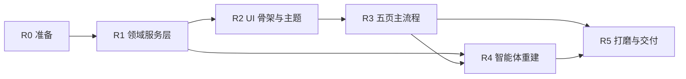

# 重构计划：AI Interferometry v2

> 阶段 3 产物。策略：**绞杀者式新建**——在新包内重建 UI / 编排 / 智能体，领域层原样接管，
> 新程序可运行即替换 `run.py` 入口，旧 `src/ui/` 保留在 git 里可随时回退，不删源码。

## 1. 目标形态

```
AI_Interferometry/
├── run.py                      → 入口（改一行指向 app/main.py；旧入口改为 run_legacy.py）
├── app/                        ← 新建：v2 全部代码
│   ├── main.py                 启动、异常兜底
│   ├── core/
│   │   ├── state.py            AppState（唯一数据源）+ 订阅机制
│   │   ├── events.py           轻量事件总线（线程安全投递到 UI 线程）
│   │   ├── config.py           读 config.yaml / v2.yaml，带范围校验
│   │   └── tasks.py            后台任务执行器（线程 + 取消 + 结果回收）
│   ├── services/
│   │   ├── capture.py          相机采集（包装 src.camera）
│   │   ├── detect.py           YOLO 推理（包装 src.vision.detector）
│   │   ├── fringe.py           中心定位 + 宽度 + 几何（包装 fringe_center/width/angle）
│   │   ├── search.py           自动寻中 + 目标读数闭环（包装 center_control）
│   │   ├── reading.py          微分表 OCR 读数（包装 micrometer_ocr）
│   │   ├── motion.py           电机 + 命令队列（包装 src.hardware）
│   │   ├── compute.py          厚度 + 不确定度 + 多轮统计（包装 src.measurement）
│   │   ├── thickness_map.py    单帧厚度分布（相对 / 标定双模式）
│   │   ├── calibration.py      颜色→光程差标定表采集（取色 + OPD + CSV 读写）
│   │   └── record.py           记录与导出（CSV/JSON/Markdown）
│   ├── ui/
│   │   ├── theme.py            配色/字体/QSS（深/浅双主题）
│   │   ├── main_window.py      主窗口、页签、全局急停
│   │   ├── widgets/            卡片、数值显示、状态灯、大画面、抽屉
│   │   └── pages/
│   │       ├── live.py         实时：画面 + 关键状态 + 主操作
│   │       ├── search.py       搜索条纹（自动寻中 / 目标读数 两个 Tab）
│   │       ├── fringe.py       条纹定位与测量
│   │       ├── reading.py      读数
│   │       ├── compute.py      计算（厚度 / 不确定度 / 多轮）
│   │       ├── map.py          厚度分布（Tab1 分析：相对/标定；Tab2 标定采集）
│   │       └── assistant.py    智能体对话
│   └── agent/                  ← 重建
│       ├── runtime.py          AgentRuntime：会话、循环、取消、流式
│       ├── tools.py            唯一工具注册表（READ/MOTION/STOP，9 个）
│       ├── guidance.py         唯一引导决策器（仅保留四阶段，合并 3 份旧实现）
│       ├── context.py          从 AppState 生成结构化快照
│       ├── knowledge.py        本地知识库检索（复用）
│       └── prompts/            系统提示词
├── src/                        ← 保留：领域层（vision / measurement / hardware / camera / control / cli）
└── docs/                       ← 本计划与进度
```

**关键约束（验收时逐条查）**
1. `app/ui/**` 禁止 import `src.hardware` / `src.camera` / `ultralytics`：只经 `services/`。
2. `app/services/**` 禁止 import 任何 GUI 库；全部可在无显示器环境单测。
3. 所有跨线程结果必须经 `core/tasks.py` + `events.py` 回 UI 线程；禁止在 Qt 回调里做阻塞 I/O。
4. 单一数据源：页面不互相调用，只读写 `AppState` 并订阅变更。
5. 单文件上限 600 行；超过就说明还有职责没拆。

## 2. 任务分解

优先级 P0 = 主流程可用；P1 = 体验/美观；P2 = 可选功能。工作量 S(<0.5d) / M(1d) / L(2–3d) / XL(>3d)。

### 阶段 R0 · 准备（0.5 天）
| ID | 任务 | 产出/验收 |
| --- | --- | --- |
| R0.1 | 提交或打 tag 冻结现状（12 个未提交文件） | `git tag pre-refactor-v2`，工作区干净 |
| R0.2 | 依赖与骨架确认 | `pyside6` 安装成功、`python -c "from PySide6.QtWidgets import QApplication"` 通过；`app/` 目录与 `run_v2.py` 可启动空窗口 |
| R0.3 | 复用接口体检 | 脚本扫描 `src/**` 是否残留 `import tkinter`；列出需收窄的公共函数签名 |

### 阶段 R1 · 领域服务层（1.5 天，P0）
| ID | 任务 | 验收 |
| --- | --- | --- |
| R1.1 | `core/config.py` + `core/state.py` + `core/events.py` + `core/tasks.py` | 单测：状态订阅、后台任务取消、事件跨线程投递 |
| R1.2 | `services/capture.py` `services/detect.py` | 用 `data/` 中录像/截图回放，能出检测框，无 GUI 依赖 |
| R1.3 | `services/fringe.py`（中心定位 + 宽度 + 角度） | 对 `Fringe width analysis/真实实验/` 样本输出与旧程序一致（±1 px） |
| R1.4 | `services/reading.py`（OCR 读数） | 用 `数据记录/` 截图得读数，格式校验 + 连续帧确认 |
| R1.5 | `services/motion.py` `services/search.py`（自动寻中 + 目标读数闭环两种模式） | 假串口注入：寻中与目标读数都能下发命令序列并收到停止 |
| R1.6 | `services/compute.py` | `h=(d2-d1)/(20(n-1))`、GUM、Grubbs 与 `tests/test_uncertainty.py` 对齐 |
| R1.7 | `services/record.py` | 导出 CSV/JSON/Markdown，字段含时间戳与不确定度 |
| R1.8 | `services/calibration.py`：画面中心线取色（`sample_colour_band`）+ OPD 计算（手动输入 或 由微分表读数差 `\|Δ\|/20×1000 μm` 自动换算）+ CSV 读写（`opd_um,r,g,b`，UTF-8-BOM） | 单测：三点采集→保存→重新读回；OPD 自动换算与旧公式一致；非单调/少于 4 点报错 |

### 阶段 R2 · UI 骨架与主题（2 天，P0/P1）
| ID | 任务 | 验收 |
| --- | --- | --- |
| R2.1 | `ui/theme.py`：深浅双主题 QSS、字体层次（数值/标题/正文）、状态色 | 截图对比：卡片圆角、hover、禁用态一致 |
| R2.2 | `ui/main_window.py`：左流程导航 + 右大画面 + 顶栏（相机/模型/急停） | 7 个页签可切换，画面跨页常驻不重连 |
| R2.3 | `ui/widgets/`：`VideoView`（ROI 框选、叠加层）、`MetricCard`、`StatusDot`、`StepCard`、`Drawer` | 组件各自可独立实例化并有 smoke 测试 |
| R2.4 | 全局急停 + 运动二次确认对话框 | 任意页面按 Esc/点急停立即停车并留日志 |

### 阶段 R3 · 七个页面（3.5 天，P0）
| ID | 任务 | 验收 |
| --- | --- | --- |
| R3.1 | `pages/live.py`：画面 + 相机/模型开关 + 关键指标 + "下一步"提示 | 打开→出画面→出检测结果的路径 ≤2 次点击 |
| R3.2 | `pages/search.py`：Tab1 自动寻中（方向策略/识别方式 + 进度 + 已搜索区间 + 高级抽屉）；Tab2 目标读数（输入目标 mm → 自动转到读数） | 与旧自动寻中/目标读数行为一致（用旧测试参数回归） |
| R3.3 | `pages/fringe.py`：中心位置、宽度、间距、倾斜角 + 一键测量 + 画面标注 | 数据与 R1.3 一致 |
| R3.4 | `pages/reading.py`：OCR 读数大字显示 + 时间戳 + 历史列表 + 复制/记录 | 读数延迟 < 1.5 s 视为有效 |
| R3.5 | `pages/compute.py`：取两条读数 → 厚度 → 不确定度 → 多轮统计 → 导出 | 与旧程序同输入同输出；一键完成全链路 |
| R3.6 | 页面路由与"下一步"串联：每页给出唯一主按钮，跨页传递本次测量对象 | 从启动到算出厚度 ≤6 次点击、零滚动 |

### 阶段 R4 · 智能体重建（2.5 天，P0）
| ID | 任务 | 验收 |
| --- | --- | --- |
| R4.1 | `agent/runtime.py`：会话、function calling 循环、流式、取消、超时 | 单测：假 provider 走通 计划→工具→汇报；取消 1 s 内返回 |
| R4.2 | `agent/tools.py`：合并两套工具为 1 套（9 个：读状态/读表/测条纹与宽度/算厚度/评不确定度/厚度分布/启动寻中/停止/急停） | `michelson tools` 输出与新注册表一致；无重复停止类语义 |
| R4.3 | `agent/guidance.py`：合并 `experiment_guidance` + `fringe_guidance` + `proactive` 为单决策器 | 对同一快照只产生 1 条建议；单测覆盖四阶段 |
| R4.4 | `agent/context.py`：从 AppState 生成快照（去 py 对象，纯 JSON） | 快照可 `json.dumps`，字段与提示词契约对齐 |
| R4.5 | `pages/assistant.py`：对话流 + 计划/工具活动列表 + 运动确认 + 离线降级标记 | 无密钥时仍能本地回答；不阻塞 UI |

### 阶段 R5 · 打磨与交付（1.5 天，P1）
| ID | 任务 | 验收 |
| --- | --- | --- |
| R5.1 | `pages/map.py` 厚度分布页：**Tab1 分析**（相对/标定模式切换、波长/折射率/标定 CSV/反转/无膜基准、伪彩叠加 + 3D 形貌 + 不均匀度指标）；**Tab2 标定采集**（设零点 → 逐点采集 OPD+RGB → 表格增删 → 保存/载入 CSV） | 与旧临时测量双模式输出一致；标定表采集→保存→在 Tab1 选用→得到标定模式厚度，全链路可跑通 |
| R5.2 | 演示模式：无硬件时用录像/图片走完整流程（比赛现场保险） | 断掉相机/电机仍可演示全部页面 |
| R5.3 | 打包与启动脚本、`README-v2.md`（安装/启动/一页流程） | 新机器按文档 3 步启动 |
| R5.4 | 回归：`pytest` 全绿 + 手动走查清单（`docs/plan/walkthrough.md`） | 40+ 测试通过；走查 12 项打勾 |
| R5.5 | 切换入口 `run.py`→v2，旧入口保留为 `run_legacy.py` | 双击 `run.py` 启动 v2 |

**总计约 10.5 个工作日**（单人、含自测；已按你的取舍砍掉回程差、录像、激光引导、主动建议、图像复核）。

## 2.1 按你的决定裁剪后的范围变化

| 变化 | 影响 |
| --- | --- |
| 保留 C5 标定采集 | `thickness_distribution` 相对 + 标定双模式都保留；`config/calibration.yaml` 与标定 CSV 流程进入「厚度分布」页 Tab2；新增 `services/calibration.py` |
| 停用 C3/C4 | "临时测量"模块消失；目标读数控制迁入「搜索」页 Tab2；`_backlash_step`（199 行）与定时采样逻辑不再迁移 |
| 停用 C7 录像 | 删除 `recording_sidebar` / `video_recorder`；`config/video_demo.yaml` 仍作为参数预设来源 |
| 停用 C12 | 删除 Arduino 相关 UI；`src/hardware/arduino.py` 源码保留 |
| 停用 B4/B6/B7 | 删除 `proactive.py`、`laser_guidance_session.py`、Vision 识图调用；`guidance.py` 只剩四阶段确定性决策 |
| 智能体完整重建 | 新建 `app/agent/` 全部；旧 `src/agent/` 保留但不再被新入口调用 |

## 3. 依赖图



## 4. 里程碑

| 里程碑 | 内容 | 判定 |
| --- | --- | --- |
| M1（R0–R1） | 服务层可在无 GUI 环境跑通"画面→条纹→读数→计算" | `pytest app/` + 一个纯脚本 demo |
| M2（R2–R3） | 新界面能真机完成主流程四步 | 现场走查通过 |
| M3（R4） | 智能体能调工具、能确认、能离线降级 | 5 个对话场景通过 |
| M4（R5） | 可交付演示 | 断硬件可演示 + 文档齐全 |

## 5. 复用与不动的部分

- 直接 import 复用：`src/vision/*`（除 `fringe_adjustment` 相关的激光引导链路）、`src/measurement/*`、
  `src/hardware/*`、`src/camera/*`、`src/control/center_control.py`、`src/config.py`（缩键后）。
- 原样保留：`models/`、`config/`、`数据记录/`、`tests/`（领域层部分）、`Fringe width analysis/`、
  `Thickness_variation_analysis/`、`报告和PPT/`。
- 停用（不删文件，只移出新入口）：`src/ui/app.py` 旧流程、`src/ui/widgets/*` 全部旧面板、
  `src/control/experiment_workflow.py`、`src/ui/recording_*`、`src/ui/widgets/video_recorder.py`、
  `src/agent/proactive.py`、`src/agent/laser_guidance_session.py`、`src/hardware/arduino.py`。
- 收回 `config.yaml` 中不再使用的键：`arduino.*`、`temporary_measurement.backlash_*`、
  `temporary_measurement.max_duration_seconds`（若无目标读数使用）、`agent.proactive_*`、
  `agent.laser_*`、`app.llm.models.vision`。

## 6. 验收标准（整体）

1. 主流程（搜索 → 定位 → 读数 → 计算）从启动到算出厚度 ≤ 6 次点击，零滚动。
2. `app/ui/**` 零硬件依赖；`app/services/**` 零 GUI 依赖（脚本化检查通过）。
3. 任一文件 ≤600 行；`app/` 合计 ≤8000 行（旧 UI+Agent 约 12,000 行）。
4. 数值结果与旧程序一致（同输入同输出，容差内），含厚度分布**相对模式与标定模式**两条路径。
5. 断相机/断电机/无 API Key 三种降级都能启动并给出明确提示。
6. 智能体工具表 = 9 个，语义不重复；运动类工具必须经确认框。
7. 颜色→光程差标定：≥4 个单调标定点可采集、保存、重新载入并用于标定模式厚度计算。
